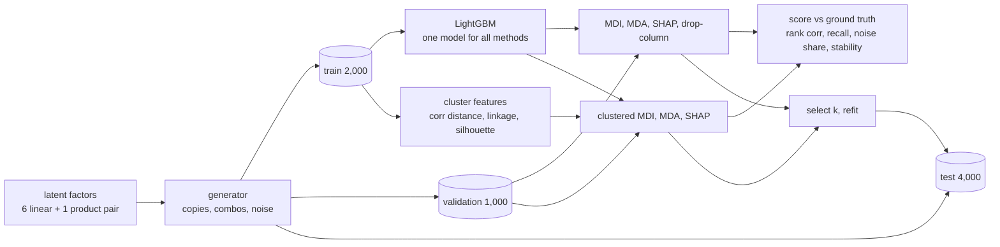

# clustered-feature-importance

[](https://github.com/Avinash186200/clustered-feature-importance/actions/workflows/ci.yml)
[](LICENSE)


Feature importance you can check: six methods (MDI, permutation, SHAP, drop-column, and clustered versions of the first three) scored against a synthetic data set whose true importance is known exactly, then tested on the question that matters, which is whether pruning by them gives a better model on untouched data.

This is the "which groups does the model actually use" companion to [feature-factory](https://github.com/Avinash186200/feature-factory). That repo generates candidate features and screens them one at a time (information coefficient, FDR control, hold-out). This one starts where that ends: hundreds of survivors, many of them near-duplicates, and one model that uses them together.

## Scenario

A quant research team has a few hundred candidate features. Many are near-duplicates: the same idea at different look-backs, or a feature and its smoothed version. They fit a tree model and rank features by importance to decide what to prune. With correlated copies, the standard methods split the credit: shuffle one copy of a strong signal and the model reads another copy, so each copy looks unimportant. A useful idea with ten variants can rank below a weaker idea with one. The team wants importance they can trust, fast enough to run over many features.

This is a scenario to frame the work. All data here is synthetic, generated in this repo with known structure, so every method can be scored against the truth and every number rebuilt.

## What it does

| part | what I built | how it is judged |
|---|---|---|
| generator | 8 latent factors (6 linear, 2 that act only through their product), each spawning 2 to 12 noisy copies at a chosen correlation; two-factor combinations; clustered and isolated noise; knobs for correlation strength, noise share and signal strength | true importance per group is the exact split of Var(y); tests check it empirically |
| clustering | correlation distance `sqrt((1 - rho) / 2)`, hierarchical linkage, number of clusters chosen per dataset by silhouette, on training features only | adjusted Rand index against the true groups |
| importance | MDI (LightGBM split gain), permutation (MDA), TreeSHAP (LightGBM `pred_contrib`, no extra dependency), drop-column, clustered MDI, clustered MDA (shuffle a whole cluster at once), clustered SHAP (sum members' SHAP values) | rank correlation with the truth (group and feature level), recall of informative groups and noise share at k, bootstrap stability |
| downstream | select k features by each method, refit, score once on 4,000 test rows; plus a one-per-cluster ablation, a cluster-means variant, random picks, all features | test R^2, with paired differences per seed |
| scale-out | permutation importance split over joblib (loky) workers, identical to the serial result bit for bit | wall time and speedup versus workers, with the machine named |

## How it works



Choices are made on development seeds 1-5 and frozen; held-out seeds 101-108 are run once. Test rows are touched only by the final downstream score.

## Results

All numbers are from synthetic data, copied from [results/RESULTS.md](results/RESULTS.md), which `make bench` rebuilds from scratch. `±` is one standard error across held-out seeds (sample sd / sqrt(n); each seed is an independent dataset with its own layout). n = 8 seeds per row in every results table except the timing table.

### Development choices

Clustering rule by adjusted Rand index against the true groups (45 development datasets): single linkage with mean silhouette scored 1.000 and was chosen; seven of the eight rules scored 0.95 or more, so on this generator the clustering is close to perfect whichever rule is used. Model by validation R^2 with a one-standard-error rule: 7 leaves, 100 rounds, learning rate 0.08. Details and both grids: [results/RESULTS.md](results/RESULTS.md).

### Base cell: correlation between copies 0.7, half the features noise

124.5 ± 5.3 features per dataset (62.2 ± 2.7 noise) in 46.1 ± 2.3 true groups; 46.1 ± 2.3 clusters found, ARI 1.000 ± 0.000. k = 8, the number of informative groups.

| method | group rank corr (true groups) | feature rank corr | recall of informative groups @8 | noise share of the 8 picks | stability: feature-score Spearman | stability: selected groups Jaccard |
|---|---|---|---|---|---|---|
| MDI | 0.64 ± 0.06 | 0.53 ± 0.02 | 0.52 ± 0.03 | 0.02 ± 0.02 | 0.43 ± 0.02 | 0.63 ± 0.04 |
| MDA (permutation) | 0.75 ± 0.05 | 0.41 ± 0.02 | 0.58 ± 0.03 | 0.00 ± 0.00 | 0.35 ± 0.02 | 0.57 ± 0.04 |
| SHAP | 0.56 ± 0.06 | 0.49 ± 0.01 | 0.56 ± 0.04 | 0.00 ± 0.00 | 0.45 ± 0.02 | 0.62 ± 0.03 |
| drop-column | 0.23 ± 0.12 | 0.09 ± 0.02 | 0.44 ± 0.05 | 0.47 ± 0.07 | - | - |
| clustered MDI | 0.64 ± 0.06 | 0.86 ± 0.01 | 0.92 ± 0.03 | 0.08 ± 0.03 | 0.92 ± 0.01 | 0.78 ± 0.02 |
| **clustered MDA** | **0.81 ± 0.04** | **0.89 ± 0.01** | **0.92 ± 0.03** | 0.08 ± 0.03 | 0.82 ± 0.01 | 0.78 ± 0.03 |
| clustered SHAP | 0.53 ± 0.04 | 0.85 ± 0.01 | 0.92 ± 0.03 | 0.08 ± 0.03 | 0.91 ± 0.01 | 0.74 ± 0.03 |
| MDA, one pick per found cluster | - | - | 0.84 ± 0.03 | 0.16 ± 0.03 | - | - |

Downstream, refit on the selected features and scored once on 4,000 test rows (test R^2):

| selection | k = 4 | k = 8 |
|---|---|---|
| MDI | 0.102 ± 0.005 | 0.121 ± 0.004 |
| MDA | 0.087 ± 0.008 | 0.118 ± 0.006 |
| SHAP | 0.096 ± 0.004 | 0.124 ± 0.005 |
| drop-column | 0.025 ± 0.014 | 0.051 ± 0.011 |
| clustered MDI, one member per cluster | 0.079 ± 0.003 | 0.103 ± 0.004 |
| clustered MDA, one member per cluster | 0.076 ± 0.004 | 0.103 ± 0.003 |
| clustered SHAP, one member per cluster | 0.086 ± 0.003 | 0.101 ± 0.003 |
| MDA, one pick per found cluster | 0.095 ± 0.006 | 0.114 ± 0.005 |
| **clustered MDA, top clusters as cluster means** | **0.119 ± 0.002** | **0.162 ± 0.003** |
| random features | 0.013 ± 0.004 | 0.035 ± 0.010 |
| all features, no selection | 0.154 ± 0.003 | |
| reference: LightGBM on the true latent factors | 0.173 ± 0.004 | |

Paired per seed at k = 8: cluster means minus all features +0.008 ± 0.001 (better in 8 of 8 seeds); cluster means minus SHAP +0.038 ± 0.002 (8 of 8); clustered MDA one-member picks minus plain MDA picks -0.015 ± 0.005 (better in 1 of 8).

What I read from this:

- **Plain importance dilutes credit across copies.** At the feature level, the score a feature gets from MDI, permutation or SHAP correlates only 0.41 to 0.53 with how important its information really is. A feature from a strong idea with many variants looks weak. Clustered scores reach 0.85 to 0.89.
- **Plain top-8 lists cover about half of the 8 real signals** (recall 0.52 to 0.58), because they spend picks on copies of the same few strongest factors. Clustered picks cover 0.92.
- **Clustering is not free on noise.** The plain top-8 lists almost never contain noise (0.00 to 0.02); the clustered ones do (0.08), because a weak real cluster can rank below a noise cluster. Deduplicating a plain MDA ranking by cluster is worse on both counts (recall 0.84, noise 0.16).
- **If you already knew the groups, plain permutation is nearly as good at ordering them.** Summed over the true groups, MDA scores 0.75 against 0.81 for clustered MDA (overlapping standard errors). Clustered MDI equals MDI here by construction, because the found clusters match the true groups exactly. Clustered SHAP orders groups worse than every method except drop-column (0.53).
- **Better rankings did not give better pruned models, until the clusters were used as features.** One member per cluster loses to the plain picks downstream (0.101 to 0.103 against 0.118 to 0.124 at k = 8), because the plain lists keep several noisy copies of the strongest factors and the model averages them. Feeding the top 8 clusters as cluster means gives 0.162, above the model on all features (0.154; 124.5 features on average).
- **Drop-column is the worst method and the most expensive** (one refit per feature). With copies present, dropping one changes almost nothing, so its scores are mostly refit noise in this single-refit setup (feature rank correlation 0.09, noise share 0.47).
- **Stability:** clustered feature scores barely move across bootstrap resamples (Spearman 0.82 to 0.92 against 0.35 to 0.45), and the set of groups they pick is more stable (Jaccard 0.74 to 0.78 against 0.57 to 0.63). This is partly by construction: members share one cluster score, and the clusters do not change between resamples. The picked features themselves are less stable (feature Jaccard 0.22 to 0.24 against 0.34 to 0.38 in [RESULTS.md](results/RESULTS.md)), because the most central member of a cluster changes between resamples.

### Sweep: correlation between copies x noise share (k = 8, n = 8 seeds per cell)

| rho | noise share | features | recall @8: MDA / clustered MDA | noise share of picks: MDA / clustered MDA | test R^2 @8: SHAP / cluster means / all features |
|---|---|---|---|---|---|
| 0.5 | 0.25 | 83 | 0.64 / 0.91 | 0.02 / 0.09 | 0.086 / 0.145 / 0.136 |
| 0.5 | 0.5 | 124 | 0.53 / 0.91 | 0.03 / 0.09 | 0.091 / 0.143 / 0.133 |
| 0.5 | 0.75 | 249 | 0.55 / 0.89 | 0.00 / 0.11 | 0.098 / 0.149 / 0.132 |
| 0.7 | 0.25 | 83 | 0.64 / 0.94 | 0.00 / 0.06 | 0.124 / 0.160 / 0.160 |
| 0.7 | 0.5 | 124 | 0.58 / 0.92 | 0.00 / 0.08 | 0.124 / 0.162 / 0.154 |
| 0.7 | 0.75 | 249 | 0.55 / 0.89 | 0.02 / 0.11 | 0.132 / 0.161 / 0.155 |
| 0.9 | 0.25 | 83 | 0.64 / 0.92 | 0.03 / 0.08 | 0.158 / 0.168 / 0.182 |
| 0.9 | 0.5 | 124 | 0.61 / 0.92 | 0.00 / 0.08 | 0.155 / 0.167 / 0.176 |
| 0.9 | 0.75 | 249 | 0.64 / 0.91 | 0.05 / 0.09 | 0.165 / 0.177 / 0.182 |

- The recall gap holds in every cell: 0.89 to 0.94 for clustered MDA against 0.53 to 0.64 for MDA.
- The clustered noise share is highest, or tied, at three-quarters noise: 0.09 to 0.11 for clustered MDA, up to 0.16 for clustered MDI and 0.19 for clustered SHAP (all methods in [RESULTS.md](results/RESULTS.md)).
- **Cluster means beat all features only when copies are noisy.** At rho = 0.5 they win in all three cells (0.143 to 0.149 against 0.132 to 0.136); at 0.7 they are level to slightly ahead; at rho = 0.9 all features win (0.176 to 0.182 against 0.167 to 0.177). With near-identical copies, averaging adds little, and the full model also uses signals ranked outside the top 8.

### Parallel permutation importance

Intel64 Family 6 Model 170 laptop, 22 logical CPUs, Windows build 10.0.26200 (Windows 11; Python reports the release as 10), Python 3.11.9. 288 features, 4,000 validation rows, 3 repeats, best of 2 passes, loky backend, pool started before timing:

| workers | wall time (s) | speedup | efficiency | identical to serial |
|---|---|---|---|---|
| 1 | 12.77 | 1.00x | 1.00 | True |
| 2 | 7.13 | 1.79x | 0.90 | True |
| 4 | 4.32 | 2.96x | 0.74 | True |
| 8 | 2.67 | 4.77x | 0.60 | True |
| 16 | 1.76 | 7.26x | 0.45 | True |

Speedup is real but sub-linear. I did not profile why; the likely causes are that each worker gets its own copy of the model and the data, the chunks are small, and on a laptop with mixed performance and efficiency cores the later workers are slower and share one power budget. The results are identical to serial at every worker count. These timings come from one machine and are never checked in CI.

## Key concepts

- **Substitution effect.** If two features carry the same signal, shuffling (or dropping) one leaves the other, so the model's score barely drops and both look unimportant. MDI and SHAP split the credit between them instead. Either way, credit per feature falls as the number of copies rises.
- **Correlation distance.** `d = sqrt((1 - rho) / 2)`: 0 for identical features, 1 for opposite ones. For standardised columns it is a scaled Euclidean distance, so it is a true metric and Ward linkage is valid on it (tested).
- **Choosing the number of clusters.** Scan k, score each cut by silhouette (how much closer each feature is to its own cluster than to the next), keep the best. The "t-stat" variant divides the mean silhouette by its standard deviation; on this generator it did worse for three of the four linkages.
- **Clustered MDA.** Shuffle every member of a cluster with one shared row permutation. The cluster's internal structure stays intact but its link to the target is broken, so no copy is left to substitute.
- **Clustered SHAP.** SHAP values add up, so a cluster's SHAP value per row is the sum of its members'. Its importance is the mean absolute value of that sum.
- **Ground truth by variance share.** The factors are independent, so Var(y) splits exactly into one share per factor (the interaction's share is split evenly between its two factors). That share is the true importance of the factor's group.
- **Development vs held-out seeds.** Every choice is made on seeds 1-5; seeds 101-108 are run once with the frozen choices. The history is in [docs/methodology.md](docs/methodology.md).

## Quick start

```bash
pip install -c constraints.txt -e ".[dev]"   # exact versions the results were made with
pytest -q                                     # summaries recomputed from runs.json; a subset of tasks rerun
make demo                                     # one dataset, every method
make bench                                    # full rerun: writes results/*.json and RESULTS.md
make verify                                   # rerun every task and check it against results/runs.json
make scale                                    # machine-specific timings -> results/scale.json
```

On Linux, LightGBM needs the OpenMP runtime (`libgomp1`, already on GitHub's Ubuntu runners). A walkthrough, including how to run it on your own feature matrix, is in [docs/walkthrough.md](docs/walkthrough.md).

## Layout

```
src/clusterfi/
  data.py         generator and ground truth
  model.py        the one LightGBM configuration, R^2
  clustering.py   correlation distance, linkage, silhouette choice of k, cluster medoids
  importance.py   MDI, MDA, SHAP, drop-column and the clustered versions; parallel permutations
  metrics.py      rank correlations, selection, recall, noise share, stability
  pipeline.py     every method on one dataset
  bench.py        development choices, held-out sweep and base cell, summaries, RESULTS.md
  scale.py        speedup versus workers
  cli.py          clusterfi bench | scale | report | demo
tests/            unit tests per module; summaries and a task subset checked against results/
results/          runs.json (per-task records), dev_choices / sweep / base summaries, scale.json, RESULTS.md
docs/             methodology, walkthrough
```

## Limitations

- **The clustering problem is easy here.** Factors are independent and copies of one factor share one correlation, so the correlation matrix is block-diagonal plus sampling noise: every within-group correlation is well above every between-group one, single linkage recovers the groups by construction, and it did so on every held-out dataset (ARI 1.000). The clustered results are therefore an upper bound, the case of perfect clustering. Real feature sets have graded, overlapping correlations (a 5-day and a 60-day momentum are related but not copies) and features that belong partly to two ideas. There, clusters will be wrong some of the time and the clustered methods will lose some of their advantage. This repo does not measure how much.
- **Drop-column is run in its simplest form.** One refit per feature, with feature fraction 0.5 and a single model seed, so refit noise is about as large as the scores themselves. Averaging several refits, or using all features in every tree, would lower that noise; with copies present its group ranking would likely still be poor. Neither variant, nor a clustered drop-column, was benchmarked here.
- **Everything is synthetic and i.i.d.** No time ordering, no regime change, no heavy tails. On a time series, the train / validation / test splits must be by time with purging and an embargo; they are random draws here.
- **k = 8 uses knowledge you would not have.** The number of informative groups is known only because the data is synthetic. The recall and noise share are reported at that k (and the downstream check also at k = 4); a team would pick k by a budget or a threshold.
- **The truth for the combination features is a judgement call.** Each combination is assigned to its dominant factor's group although it also carries the other factor.
- **"Group rank correlation" for the plain methods sums their scores over the true groups.** No analyst would have those groups; it is the most generous reading of the plain methods. Read that way, plain MDA trails clustered MDA only within the standard errors (0.75 ± 0.05 against 0.81 ± 0.04).
- **MDI here is LightGBM split gain,** the boosted analogue of mean decrease in impurity, not the random-forest MDI with one feature per split. SHAP is LightGBM's path-dependent TreeSHAP, not interventional SHAP.
- **One model family and one small model.** A random forest, a linear model or a deep tree ensemble could change the plain methods' numbers. The model setting was chosen with a one-standard-error rule for run time, not for the best validation R^2.
- **Small n per row.** 8 held-out seeds per row and 4 bootstrap resamples per seed; some differences in the tables are within one or two standard errors and should be read as ties. The "reference" row is LightGBM on the true factors, not a ceiling: the population R^2 is 0.25, and at rho = 0.9 the full feature set beats it with this learner.
- **The scale-out is one machine and one backend.** loky processes on a Windows laptop; no Dask or Ray run, no multi-machine numbers. The O(p^2) correlation step is not distributed and becomes the bottleneck well before 20,000 features.

## License

MIT. See [LICENSE](LICENSE).
